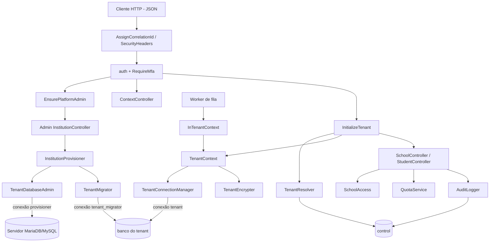
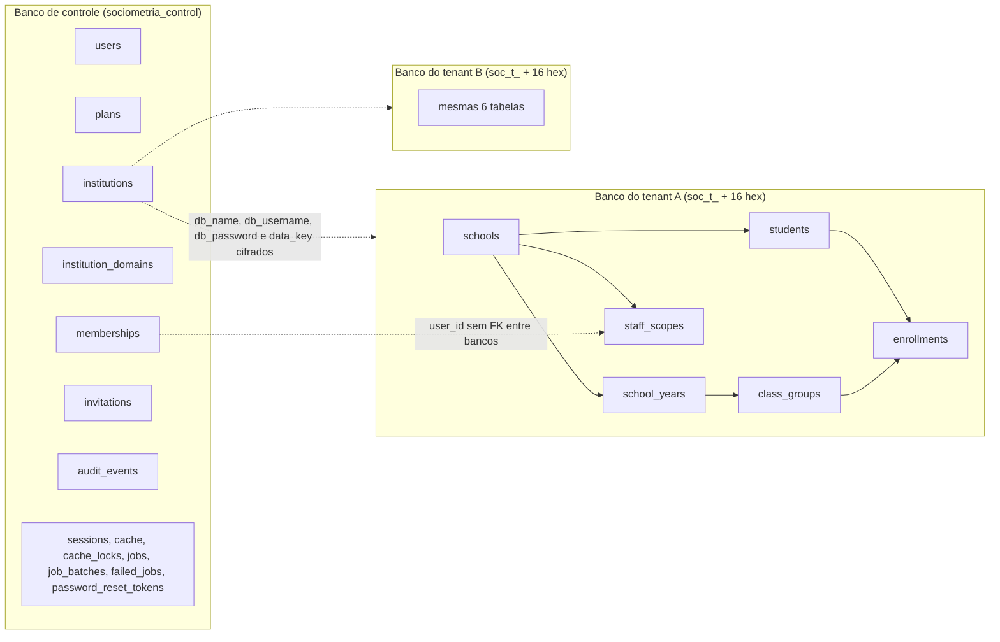

# Arquitetura multi-tenant

Modelo adotado: **um banco MariaDB/MySQL por instituição** (tenant), com credencial de banco exclusiva, mais um **banco de controle** central com metadados da plataforma. Este documento descreve o que está no código hoje.

## Estado

### Implementado e testado

| Item | Código | Evidência (testes) |
|---|---|---|
| Quatro conexões (`control`, `tenant`, `provisioner`, `tenant_migrator`); `control` é a padrão | `config/database.php` | `ProvisioningTest`, `ContextSwitchingTest` |
| Contexto institucional único por processo, sem empilhamento, com limpeza obrigatória | `app/Tenancy/TenantContext.php` | `test_rapid_alternation_between_institutions_never_mixes_data`, `test_tenant_context_and_connection_are_cleared_after_every_request` |
| Conexão `tenant` dinâmica, destruída (`purge`) a cada troca/saída | `app/Tenancy/TenantConnectionManager.php` | `test_tenant_connection_is_unusable_after_leaving_context` |
| Resolução do tenant só por dados do servidor (usuário, sessão, host) | `app/Tenancy/TenantResolver.php`, `app/Http/Middleware/InitializeTenant.php` | `test_tenant_identifier_sent_by_the_browser_is_ignored`, `test_forged_session_selection_without_membership_is_denied`, `test_verified_domain_binds_requests_to_its_institution_only` |
| Modelos de tenant inutilizáveis sem contexto e bloqueio de gravação cruzada | `app/Models/Tenant/TenantModel.php` | `test_tenant_models_are_unusable_without_context`, `test_object_loaded_in_one_institution_cannot_be_written_in_another` |
| Cifra de campos de aluno com chave por instituição (DEK) | `app/Tenancy/TenantEncrypter.php`, `app/Casts/TenantEncrypted.php` | `test_student_identifiers_are_encrypted_at_rest_with_per_institution_key` |
| Cache com namespace por instituição | `app/Tenancy/TenantCache.php` | `test_cache_is_namespaced_per_institution` |
| Jobs com contexto revalidado e payload cifrado | `app/Tenancy/Queue/TenantJob.php`, `InTenantContext.php`, `app/Providers/AppServiceProvider.php` | `TenantJobTest` (4 testes) |
| Provisionamento com verificação de isolamento | `app/Tenancy/Provisioning/*` | `ProvisioningTest` (7 testes) |
| Trilha de auditoria encadeada por hash no banco de controle | `app/Services/AuditLogger.php` | `AuditTest` (3 testes) |

Implementado **sem teste automatizado**: comando `tenants:migrate` (`app/Console/Commands/TenantsMigrate.php`); limitador `throttle:tenant` (`AppServiceProvider`); `Institution::limit()` com `limit_overrides`.

### Projetado, ainda não implementado

| Item | Etapa |
|---|---|
| Interface web (hoje só endpoints JSON; `bootstrap/app.php` força JSON em todos os erros) | 4–7 |
| Gestão completa da estrutura escolar por API (turmas, anos letivos, matrículas, escopos de equipe: só existem no esquema) | 4 |
| Questionários, motor sociométrico, dashboards, relatórios/PDF, uploads | 5–8 |
| Cadastro e verificação automatizada de domínios institucionais (não há endpoint; `verified_at` é preenchido manualmente) | 3 (pendência) |
| Backups por tenant, monitoramento, acesso emergencial de suporte | 9 |
| Offboarding, exclusão e anonimização | 9–10 |
| Banco de tenant em servidor separado (variáveis `TENANT_DB_HOST`/`TENANT_DB_PORT` existem, mas o host é único para todos os tenants) | 10 |

## Componentes

## Conexões de banco

| Conexão | Credencial | Uso | Banco |
|---|---|---|---|
| `control` | `DB_USERNAME` | Runtime do banco de controle; também sessões, cache, fila (`.env.example`: drivers `database`) | fixo |
| `tenant` | conta exclusiva da instituição (`institutions.db_username`) | Runtime institucional; nasce com `database/username/password = null` | definido por `TenantConnectionManager::connect()` |
| `provisioner` | `TENANT_PROVISIONER_USERNAME` | `CREATE DATABASE`, `CREATE/ALTER/DROP USER`, `GRANT` | nenhum |
| `tenant_migrator` | mesma do provisionador | Migrations de `database/migrations/tenant` em **um** banco por vez | apontado por `TenantMigrator::point()` |

Nenhuma conexão usa `root`. A conta de runtime do tenant recebe apenas `SELECT, INSERT, UPDATE, DELETE` no próprio banco.

## Bancos e tabelas

- Banco de controle: `database/migrations/2026_11_10_000001_create_control_plane_tables.php` (+ migrations padrão do Laravel). Não guarda dados de estudantes.
- Banco de tenant: `database/migrations/tenant/2026_11_10_100001_create_school_structure_tables.php`. `staff_scopes.user_id` referencia `users.id` do banco de controle sem chave estrangeira.

## Ciclo de uma requisição institucional (`/app/*`)

1. `auth` + `RequireMfa`: sessão autenticada com segundo fator concluído.
2. `InitializeTenant` chama `TenantResolver::resolve(user, host, sessão)`, que consulta o banco de controle a cada requisição (sem cache): usuário ativo, vínculo (`memberships`) ativo, host da plataforma ou domínio verificado, instituição `active`.
3. `TenantContext::enter()` configura a conexão `tenant` e carrega a DEK.
4. O controlador busca recursos por `public_id` (ULID) e aplica `SchoolAccess`; fora do escopo retorna 404.
5. `finally`: `TenantContext::leave()` fecha a conexão e descarta a chave.

Falha na resolução gera evento `tenant.resolve`/`denied` e resposta 403 (ou 409 `context_selection_required` quando o usuário tem mais de um vínculo e não selecionou contexto em `POST /context`).

## Jobs e comandos

- Todo job institucional deve estender `TenantJob` (transporta só `institutionPublicId` e `actorUserId`; payload cifrado via `ShouldBeEncrypted`). `InTenantContext` recarrega a instituição, exige `active` e, se houver ator, vínculo ativo; caso contrário descarta o job e audita `job.context`/`denied`.
- `AppServiceProvider` limpa o contexto antes e depois de qualquer job (`JobProcessing`, `JobProcessed`, `JobFailed`, `JobExceptionOccurred`).
- Não existe hoje nenhum job de negócio em `app/`; o único `TenantJob` concreto está em `tests/Feature/Tenancy/TenantJobTest.php`.
- `php artisan tenants:migrate [--institution=<public_id>] [--force]` migra instituições `active` e `suspended`, uma por vez; falha em uma não interrompe as demais.

## Limites conhecidos

- Todos os bancos ficam no mesmo servidor de banco; o isolamento é por banco + credencial, não por máquina.
- Escolas da mesma instituição compartilham o mesmo banco (ver `ISOLAMENTO_ESCOLAS.md`).
- Sessões, cache e fila ficam no banco de controle; o namespace de cache por tenant é lógico (prefixo `tenant:<public_id>:`).
- A proteção de `TenantModel` contra gravação cruzada vale para modelos Eloquent; consultas diretas via `DB::connection('tenant')` dependem apenas da conexão ativa.
